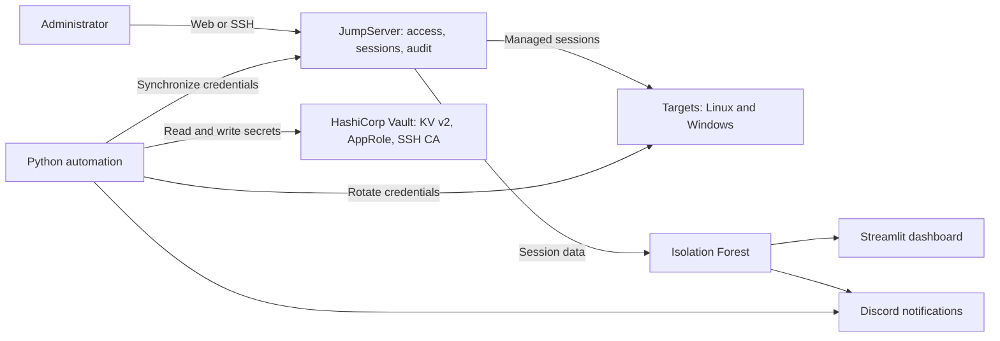
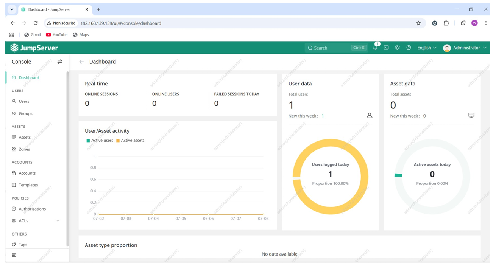
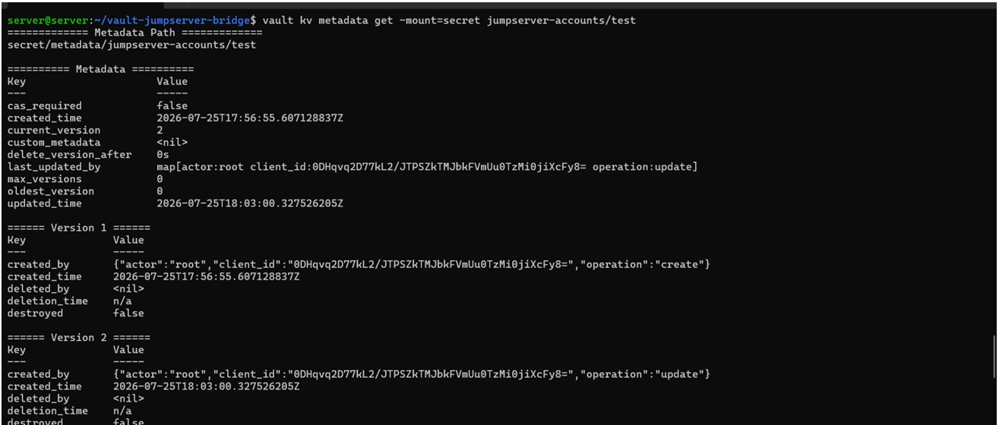
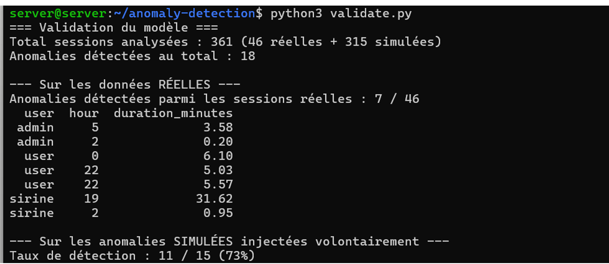
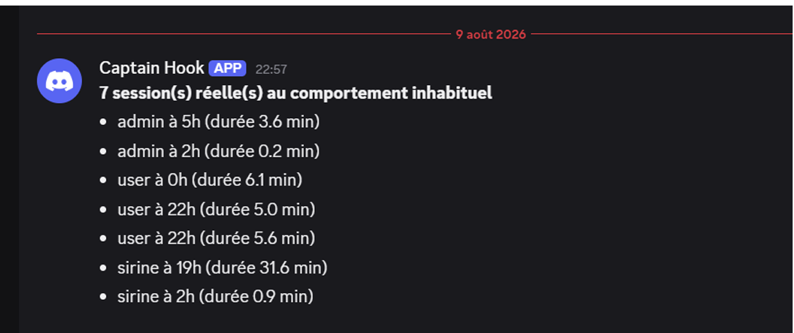

# Privileged Access Management with JumpServer and HashiCorp Vault

A laboratory implementation of a Privileged Access Management (PAM) solution, developed during a cybersecurity engineering internship in 2026. It centralizes and audits privileged access, manages secrets with HashiCorp Vault, automates password rotation, and flags unusual sessions using a machine-learning model.

## Problem

Privileged accounts are high-value targets. Static passwords, shared administrator accounts, and missing session traces make misuse difficult to prevent and investigate.

This project addresses the following question:

> How can privileged access be controlled and secured, secrets protected, sessions traced, and unusual user behavior detected automatically?

## Highlights

| Area | What was built |
|---|---|
| Access control | Named users, MFA where configured, authorization rules, login ACLs, and session time limits |
| Command filtering | Configured filtering for potentially risky commands |
| Audit | Recorded and replayable sessions, with command history where available |
| Secrets | Vault KV v2 for versioned secret storage |
| Least privilege | Vault AppRole authentication with a restricted policy |
| Rotation | Password rotation workflow involving the target host, Vault, and JumpServer |
| SSH certificates | Documentation and exploration of short-lived SSH certificates signed by a Vault CA |
| Anomaly detection | Isolation Forest session analysis, with dashboard and notifications |
| Multi-OS | Password rotation workflow validation against Linux and Windows targets |

## Architecture

The documented solution combines JumpServer, HashiCorp Vault, Python automation, target machines, and a session-analysis workflow.



See [Architecture Documentation](docs/architecture/architecture.md) for the component overview and workflow.

## Results at a Glance

The project report documents session analysis involving real lab sessions and simulated data.

| Metric | Value |
|---|---:|
| Sessions analyzed | 361 (46 real, 315 simulated) |
| Anomalies flagged | 18 |
| Flagged among real sessions | 7 of 46 |
| Injected anomalies detected | 11 of 15 (73%) |

The 73% figure refers to injected anomalies in the evaluated simulated dataset. It is not a measure of expected production performance.

See [Detailed Results](docs/results/results.md) for further information.

## Repository Contents

```text
.
├── docs/
│   ├── architecture/
│   │   └── architecture.md
│   ├── results/
│   │   └── results.md
│   └── screenshots/
│       ├── 01-jumpserver-access-control.png
│       ├── 02-vault-secret-management.png
│       ├── 03-anomaly-detection.png
│       └── 04-discord-alert.png
├── policies/
│   └── README.md
├── .env.example
├── .gitignore
└── README.md
```

## Screenshots

### JumpServer — Access Control



### HashiCorp Vault — Secret Management



### Session Anomaly Detection



### Discord Alert



## Context

Cybersecurity engineering internship project, STEG, ESPRIT, academic year 2025–2026.