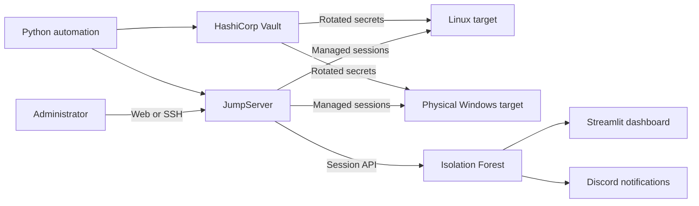
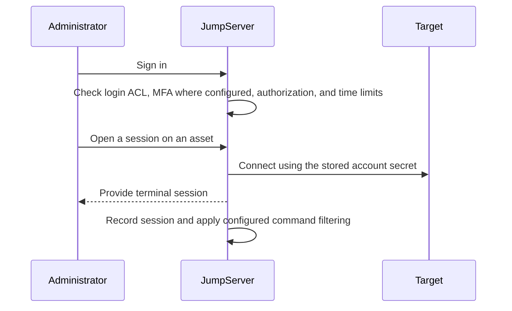
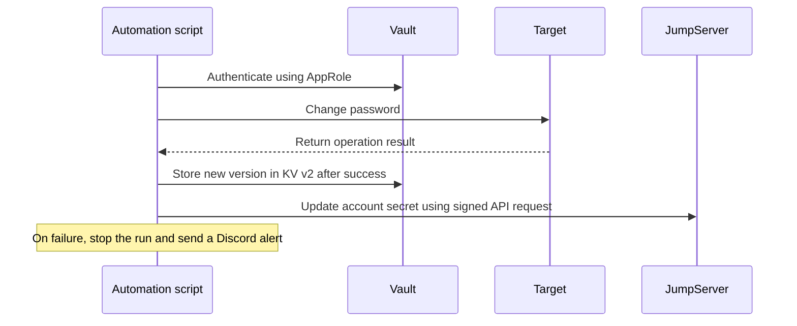

# Architecture

## 1. Overview

The lab consists of three virtual machines (JumpServer, Vault, and a Linux target) and one physical Windows target. JumpServer is the single entry point for administrators. Vault manages secrets, while Python automation coordinates password rotation, credential synchronization, and the anomaly-detection workflow.

## 2. Architecture Diagram

## 3. Components

| Component | Role | Notes |
|---|---|---|
| JumpServer Community Edition | Bastion, access control, session recording | Selected after comparing alternatives |
| HashiCorp Vault | KV v2, SSH CA, AppRole | File storage and Shamir unseal |
| Python automation | Password rotation and synchronization | Uses `hvac`, `requests`, and `paramiko` |
| Anomaly detection | Session scoring | Batch processing with Isolation Forest |
| Dashboard and alerts | Monitoring and notifications | Streamlit and Discord |
| Targets | Linux and Windows | Windows target used for validation |

## 4. Workflows

### 4.1. Privileged Session

### 4.2. Password Rotation

The intended order is **target first, then Vault, then JumpServer**. This avoids updating Vault before the target password has been changed successfully. JumpServer is updated last to keep its stored account credential synchronized.

### 4.3. Anomaly Detection

1. Extract collected sessions through the JumpServer API.
2. Convert durations and timestamps into numeric values.
3. Build features such as hour, night, weekend, duration, and user frequency.
4. Score sessions using an Isolation Forest model configured with 200 trees.
5. Send alerts for real sessions flagged as unusual and update the dashboard.

This pipeline runs after sessions have been collected. It is not continuous, real-time detection.

## 5. Design Decisions

| Decision | Reason |
|---|---|
| Separate Vault and JumpServer | Provides specialized secret management and separates access management from secret storage |
| AppRole instead of a root token | Limits automation to the permissions granted by its policy |
| KV v2 | Maintains version history for secrets updated during password rotation |
| Isolation Forest | Supports anomaly detection without requiring labeled training data |
| Target, then Vault, then JumpServer | Updates the target first and synchronizes the stored credentials afterward |

## 6. Security Considerations

- Apply least-privilege access policies to Vault and JumpServer.
- Avoid using Vault root tokens for routine automation.
- Protect AppRole credentials and API authentication material.
- Restrict access to session recordings and logs.
- Never commit passwords, tokens, private keys, or webhook secrets to GitHub.
- Log rotation failures and document recovery procedures.

## 7. Limitations

- Anomaly detection depends on the available session data and selected features.
- A flagged session is not necessarily malicious.
- Batch processing introduces a delay between session activity and analysis.
- Password synchronization may become inconsistent if an update fails.
- Laboratory results do not automatically demonstrate production readiness.

## 8. Conclusion

The architecture integrates JumpServer for privileged access, HashiCorp Vault for secret management, Python automation for credential synchronization, and Isolation Forest for session anomaly detection. Together, these components demonstrate a modular approach to privileged access control and security monitoring.
